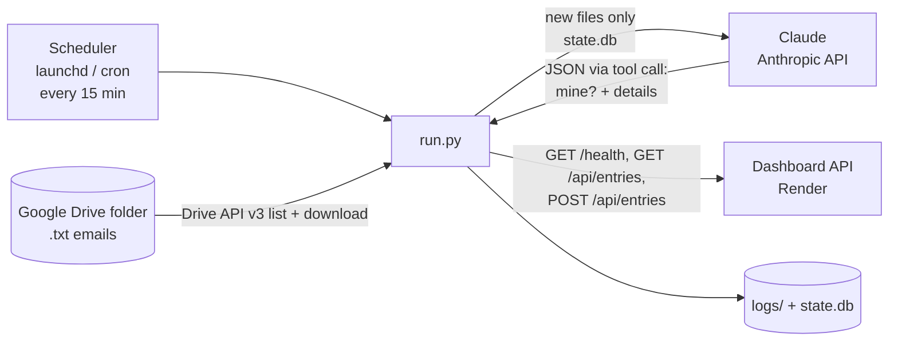

# Trainer Central → Dashboard automation (Claude) — Python backup implementation

Reads Trainer Central submission emails (`.txt`) from a shared Google Drive folder, uses **Claude** to decide which ones
are mine and extract the assignment details, and pushes them to the trainer's dashboard API. Runs locally every
15 minutes with no manual steps.

(The main, Claude scheduled-task solution is described in [README.md](README.md). This file documents the Python backup.)

## Architecture



Per run: list Drive files → drop ones already in `state.db` → for each new file: empty? skip → same email already
pushed? skip → **Claude** returns structured JSON (`is_trainer_central_submission`, `is_for_target_learner`, assignment
name, submission time, status, course, other details) → safety check that my email/name really occurs in the file →
`GET /health` (wake Render) → check dashboard for my `[ref:…]` marker → `POST /api/entries` once → record in `state.db`.

## Files

| File | Purpose |
|---|---|
| `run.py` | Orchestrator (one invocation = one run) |
| `sources.py` | Google Drive (API key) and local-folder sources |
| `analyzer.py`, `prompts/analysis_prompt.md` | The Claude step and its prompt (forced JSON via tool use) |
| `dashboard.py` | API client: health wake-up, retries, no-double-post logic |
| `state.py` | SQLite record of processed files |
| `scheduler/` | launchd installer, cron/Task Scheduler examples |
| `tests/e2e_local.py` | End-to-end test: edge-case samples + fake dashboard |

## Setup (macOS)

```bash
cd tc_automation
python3 -m venv .venv && source .venv/bin/activate
pip install -r requirements.txt
cp .env.example .env && chmod 600 .env       # then fill in the values (see below)
```

`.env` (never commit/submit it): `ANTHROPIC_API_KEY`, `LEARNER_NAME`, `LEARNER_EMAIL`, `SENDER_NAME` (same value on
every push), `DRIVE_FOLDER_ID`, `GOOGLE_API_KEY`, optional `TRAINER_API_KEY`.

**Google Drive access.** The trainer's folder is shared "anyone with the link", so a plain API key is enough:
Google Cloud Console → new project → enable *Google Drive API* → Credentials → *Create API key* → put it in
`GOOGLE_API_KEY`. (Restrict the key to the Drive API.)

## Run

```bash
python run.py --dry-run          # real Drive + real Claude, but nothing is POSTed
python run.py                    # real run
python tests/e2e_local.py        # offline end-to-end test (uses Claude, fake dashboard)
scheduler/install_launchd.sh install   # schedule every 15 min; also: status | uninstall
```

Logs: `logs/trainer_central.log` (human readable), `logs/runs.jsonl` (one JSON summary per run: files seen, matched,
pushed, API status). Inspect state: `sqlite3 state.db "select name,status,entry_id,processed_at from processed"`.

## How the requirements are met

- **R1** Drive listing via Drive API; `state.db` stores file id + md5, so only new/changed files are processed.
- **R2/R3** Claude decides ownership and extracts details; prompt is in `prompts/analysis_prompt.md`. Output is forced
  through a tool schema, so it is always valid JSON. File text is treated as untrusted data (prompt-injection safe).
- **R4** `POST /api/entries` with `{"text": ..., "sender": ...}`; response status logged.
- **R5** Three layers: local state per file; one dashboard entry per email (`Message ID`, else content hash) so a
  duplicate copy of the same email is skipped; and a `[ref:…]` marker in the pushed text that is looked up via
  `GET /api/entries` before posting (survives deleting `state.db`, and lost-response retries).
- **R6/R7** launchd job on this Mac, every 15 min.
- **R8** Retries with backoff for Drive/API; Render cold-start handled via `/health`; empty/unrelated/other-learner files
  recorded and skipped; any per-file failure is logged and retried next run without stopping the run.

## Assumptions

- Emails look like the ones on the dashboard: header lines (`Subject`, `From`, `Date`, `Message ID`) and a body "The learner
  <email> has submitted their assignment under the topic <title> as part of the course curriculum for <cohort>".
- The learner is identified by email (primary) or full name. If the assignment title is missing, the entry is still pushed
  as `Assignment: (not stated in email)` so the submission is not lost.
- Submission time = explicit time in the body if present, else the email's `Date` header.
- `x-api-key` is an optional header in the API spec (`TRAINER_API_KEY`); try without it first. `GET /api/entries` is paged (`limit`/`skip`) and supports `q`; the duplicate check uses both.
- The Mac must be awake and online for runs to happen (launchd runs a missed job after wake-up). Keep it awake during
  the trainer's one-hour test (`caffeinate -s`).

## Evidence checklist (deliverables)

1. Screenshot of your entry on the dashboard.
2. `logs/runs.jsonl` / `trainer_central.log` showing at least two scheduled runs (look for runs with no manual trigger).
3. Timing proof: Trainer Central submission time vs. the dashboard entry's `created_at` (under 1 hour).
4. This README + the architecture diagram above.
5. Source, prompts and scheduler config — with no secrets (`.env` and `state.db` are git-ignored).
